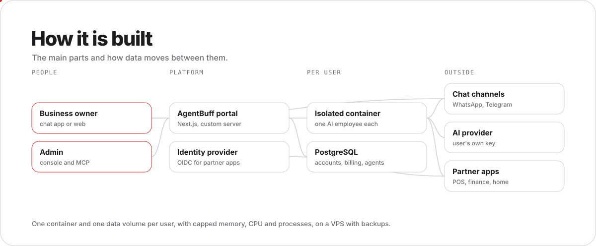
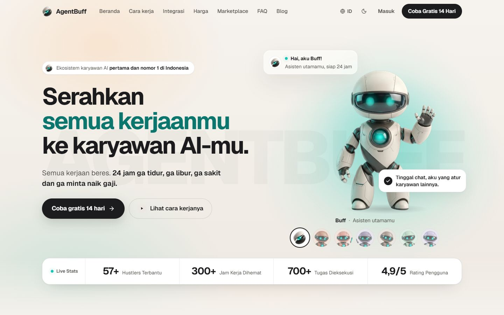
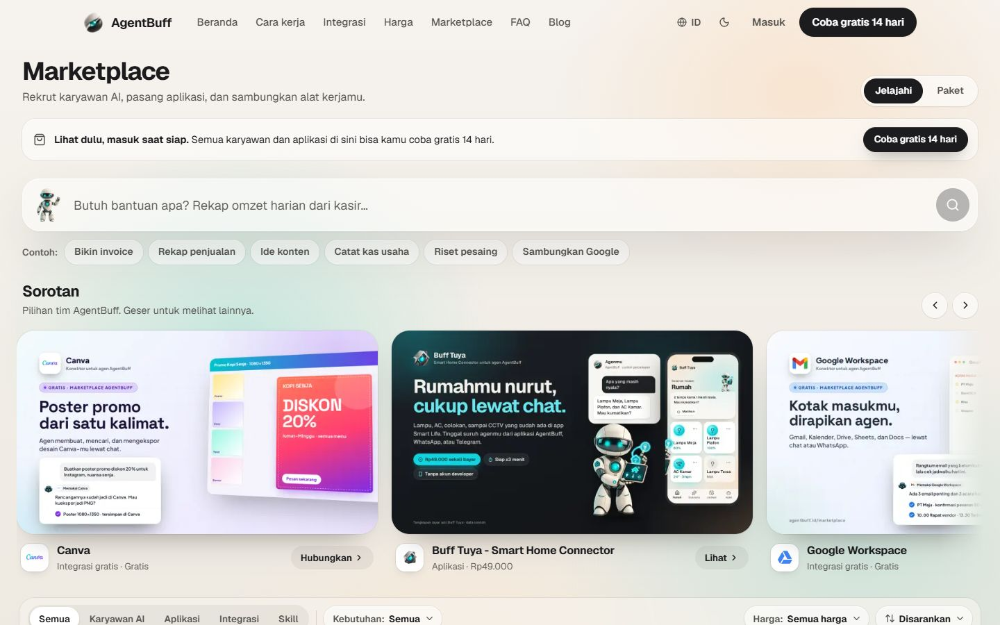

<!-- Showcase repository: the product is real and in use, its source code is private. -->

<a href="https://agentbuff.id"><picture><source media="(prefers-color-scheme: dark)" srcset="assets/banner-dark.svg"></picture></a>

<a href="https://agentbuff.id"><b>Open agentbuff.id</b></a> · <a href="https://github.com/nugrahalabib">More of my work</a> · <a href="https://nugrahalabib.com">nugrahalabib.com</a> · <a href="mailto:nugrahalabib@gmail.com">Email</a>

## Overview

AgentBuff gives small businesses, freelancers and creators an AI employee they talk to in the chat apps they already use. Each user gets an isolated AI employee in its own container, working 24/7 in WhatsApp, Telegram and other chat apps.

A small business has the same work as a large one: orders to recap, customers to answer, reports to send. It has no team to hand that work to, and most AI tools ask the owner to learn a new app first. AgentBuff goes the other way and puts the employee inside the chat.

Users bring their own AI key or login, so they control cost. A marketplace adds skills, connectors and full business apps on top.

| | |
| --- | --- |
| **Status** | Running at [agentbuff.id](https://agentbuff.id) |
| **Role** | Founded and led by Nugraha Labib Mujaddid, CEO of AgentBuff, who designed and built the platform. |
| **Period** | Since May 2025 |
| **Source** | Private. This repository presents the product; the code is not published. |

<picture><source media="(prefers-color-scheme: dark)" srcset="assets/features-dark.svg"></picture>

Features as text

- **Ready-made AI employees.** Hire a packaged employee such as a cashier assistant, a bookkeeper or a customer service agent, and it is working in your chat in minutes.
- **Custom agents.** Build your own agent with a persona, skills, channels and routines. One account can run several agents, each with its own context.
- **Work where you chat.** Agents answer in WhatsApp, Telegram, Slack, Discord, Google Chat and email. Replies are paced to feel human, not instant bursts.
- **Voice calls.** Call your agent live from the web app. It can also answer with voice notes in the chat channels.
- **Marketplace.** Skills, connectors and business apps in one catalog: Kasir POS, Buff Your Money, KostCloud, Absentra and Smart Home.
- **Policy layers.** Platform rules are layered into every agent's instructions, so each employee stays inside what the business allows.
- **Billing.** Checkout with QRIS, e-wallets and virtual accounts through Midtrans, with trials, coupons, refunds and PDF receipts.
- **Sign in with AgentBuff.** An identity provider for partner apps. One login, one entitlement check, and the agent connects to the app over MCP.

<picture><source media="(prefers-color-scheme: dark)" srcset="assets/architecture-dark.svg"></picture>

<picture><source media="(prefers-color-scheme: dark)" srcset="assets/stack-dark.svg"></picture>

## Engineering highlights

- Every user runs in a separate container with dropped capabilities, no inter-container traffic and resource limits.
- An admin MCP server with its own OAuth lets an AI assistant operate the admin console.
- Hundreds of end-to-end proof scripts and guard checks cover purchases, MCP and rollout.
- Skills and agents reinstall themselves from the database after a container rebuild.

## Screens

Landing page

Marketplace catalog

---

Built by [Nugraha Labib Mujaddid](https://github.com/nugrahalabib). This page describes a private codebase; questions about the product or a demo are welcome at [nugrahalabib@gmail.com](mailto:nugrahalabib@gmail.com).
